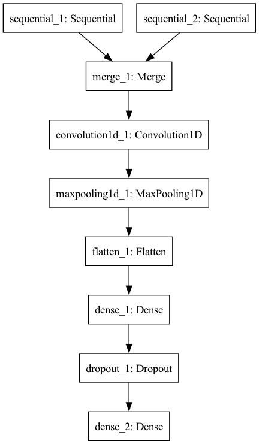

# Authorship Attribution (Stylometric Features VS CNNs)
Authorship Attribution can be defined as, given a set of documents from a set of authors, identify the author of an unseen document. This project is an attempt to do authorship attribution on blogs dataset, using multi channel CNNs and compare its performance with the traditional Machine Learning methods using stylometric feature sets like basic-9 and writeprints. The results show that multi channel CNNs outperform the traditional Machine Learning methods.

# Motivation
One important scenario where authorship attribution models are being used is the identification of disputed documents. The problem arises when 2 or more people claim the authorship for a particular document. Another scenario is to attribute the old historical pieces of writings to different eras, or perhaps the original author as well. Hence there is a need to have strong authorship attribution models.

# Dataset
The dataset to be used in this project is called Blogger dataset. The collected posts are from 19,320 bloggers gathered from blogger.com in August 2004. I am downloading corpus from (http://u.cs.biu.ac.il/~koppel/BlogCorpus.htm). According to this source "The corpus incorporates a total of 681,288 posts and over 140 million words - or approximately 35 posts and 7250 words per person.  

Each blog is presented as a separate file, the name of which indicates a blogger id# and the blogger’s self-provided gender, age, industry and astrological sign. (All are labeled for gender and age but for many, industry and/or sign is marked as unknown.)

All bloggers included in the corpus fall into one of three age groups:

        8240 "10s" blogs (ages 13-17)

        8086 "20s" blogs(ages 23-27)

        2994 "30s" blogs (ages 33-47)

For each age group there are an equal number of male and female bloggers.   

Each blog in the corpus includes at least 200 occurrences of common English words. All formatting has been stripped with two exceptions. Individual posts within a single blogger are separated by the date of the following post and links within a post are denoted by the label urllink. 

Original Paper: http://u.cs.biu.ac.il/~schlerj/schler_springsymp06.pdf.

# Machine Learning Models

- **FFNN + Basic 9**
- **SVM + Writeprints Limited**
- **RFC + Writeprints Limited**
- **SVM + Writeprints Static**
- **RFC + Writeprints Static**
- **Multi Channel CNN with a static and non static channel both initialized with Glove word embeddings**

### Technical Details

- Programming Language: Python
- Data Cleaning: NLTK, Regular Expressions
- Feature Extraction: NLTK, Spacy, Pandas
- Machine Learning: Scikit-Learn, Keras

### Multi Channel CNN
I use Convolutional Neural Network (CNN) classifier with word embeddings for authorship attribution. More specifically, each word is mapped to a continuous-valued word vector using Word2Vec. Each input document is represented as a concatenation of word embeddings where each word embedding corresponds to a word in original document. The CNN model is trained using these document representations as input for authorship attribution. Then I train the multi-channel CNN consisting of a static word embedding channel (word vectors trained by Word2Vec) and a non-static word embedding channel (word vectors trained initially by Word2Vec then updated during training).
This feature set includes lexical and syntactic features.

The code used in this method is an implementation of CNN-Word-Word model from https://arxiv.org/abs/1609.06686

### Writeprints
For writeprints-static we have Lexical features which include character-level and word-level features such as total words, average word lenght, number of short words, total characters, percentage of digits, percentage of uppercase characters, special character occurances, letter frequency, digit frequency, character bigrams frequency, character trigrams frequency and some vocabulary richness features. 
Syntactic features include counts of function words (e.g., for, of), POS tags (e.g., Verb, Noun) and various punctuation (e.g., !;:). 
As suggested by literature review, these features are used with Support Vector Machine (SVM) classifier.

### Basic - 9
Basic - 9 Feature set used in this setting includes the following 9 features covering character-level, word-level and sentence-level features alongwith some readability metrics: character count (excluding whitespaces), number of unique words, lexical density (percentage of lexical words), average syllables per word, sentence count, average sentence length, Flesch-Kincaid readability metric, and Gunning-Fog readability metric. As suggested by literature review, we use the basic-9 feature set with a Feed Forward Neural Network (FFNN) whose number of layers were varied as a function of (number of features + number of target authors)/2.

# Instructions to Run Code
## Demo
<!--  -->

This code requires python3.6. 
1) Clone the repository: `git clone https://github.com/asad1996172/Authorship-attribution-using-CNN/`
2) Install minconda: https://docs.conda.io/en/latest/miniconda.html
3) Create a conda environment: `conda create -n aacnn python=3.6`
4) Activate the environment: `conda activate aacnn`
5) Install the requirements:`pip install -r requirements.txt`
6) Go to each folder and run classifier

# Results 
Following table summarizes the results for 5 authors and 10 authors setting in blogs dataset. It shows that the our CNN method outperforms the traditional Machine Learning methods.

|Setting   |Wrtiperints Static + SVM   |Basic-9 + FFNN   | Multi Channel CNN  |
|---|---|---|---|
|Blogs 5-Authors   |%   |%   |%   |
|Blogs 10-Authors   |%   |%   |%   |
